# 🛣️ RoadVision AI

**Smart City Road Monitoring System** — AI-powered detection of potholes, cracks and other road damage, with role-based dashboards for citizens, municipality admins and maintenance crews.

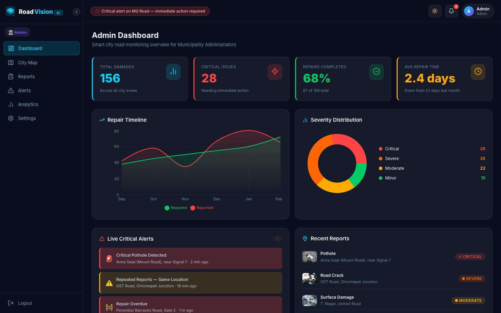

---

## ✨ Features

- **AI damage detection** — a YOLOv8 model trained on the RDD2022 road damage dataset detects potholes, longitudinal / transverse / alligator cracks, surface damage, manholes and drainage issues.
- **Live detection** — run detection on the device camera in real time from the browser.
- **Report damage** — citizens upload a photo, the AI fills in the damage type, and they add location and severity.
- **Interactive city map** — every report plotted by severity, with filters and a heatmap (OpenStreetMap, no API key needed).
- **Admin dashboard** — KPIs, repair timeline, severity distribution, live critical alerts and report management.
- **Analytics** — trends and breakdowns across city zones.
- **Maintenance crew view** — assigned repair tasks with task details.
- **Safe route** — plan a route that avoids reported hazards.
- **Dark / light theme** and a **mobile-friendly layout** with bottom navigation and an account menu.

## 👥 Roles

| Role | What they can do |
|------|------------------|
| 🚴 **Citizen** | Report damage, run live detection, view the map, track their reports, plan safe routes |
| 🏛️ **Municipality Admin** | City map and heatmap, manage reports, analytics, alerts |
| 👷 **Maintenance Crew** | View and update assigned repair tasks |

---

## 📸 Screenshots

### Login
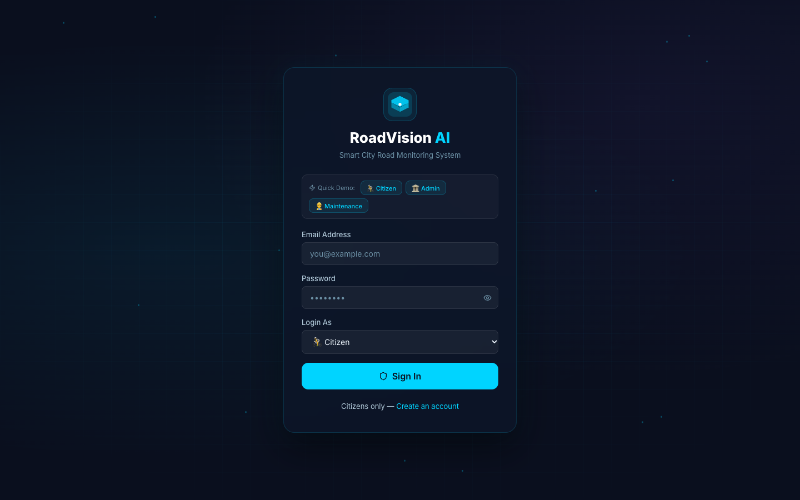

### Admin — City Map
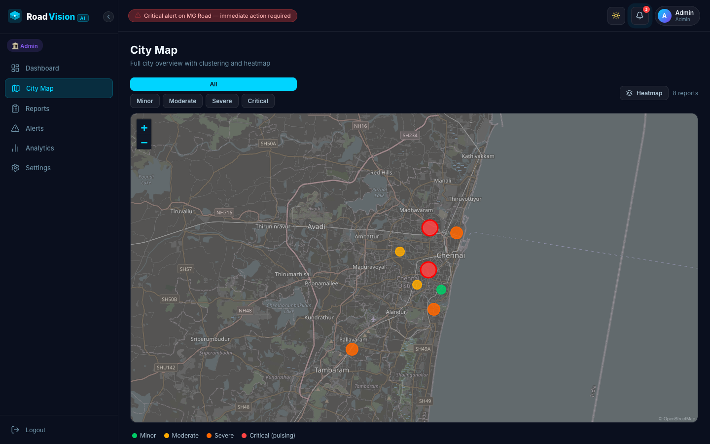

### Admin — Reports Management
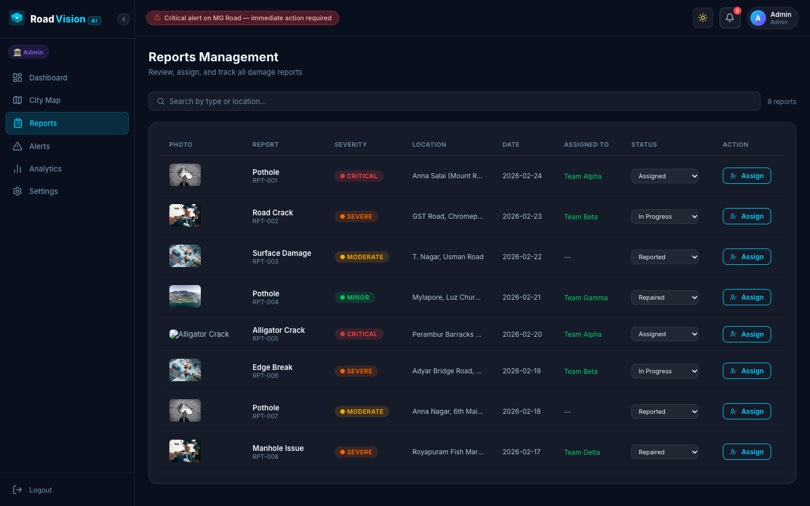

### Admin — Analytics
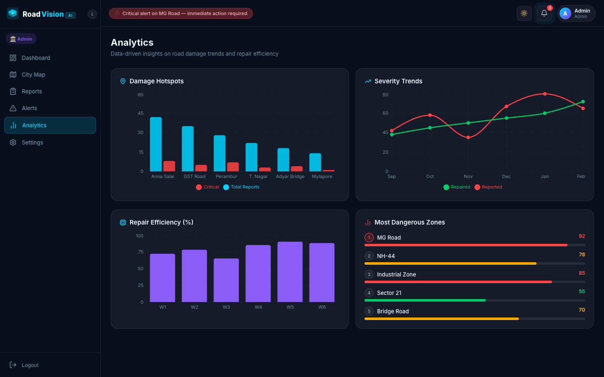

### Admin — Alerts
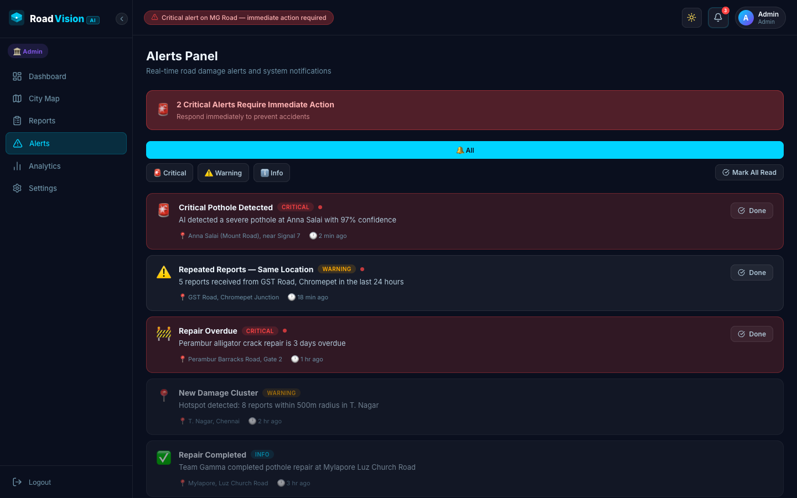

### Citizen — Dashboard
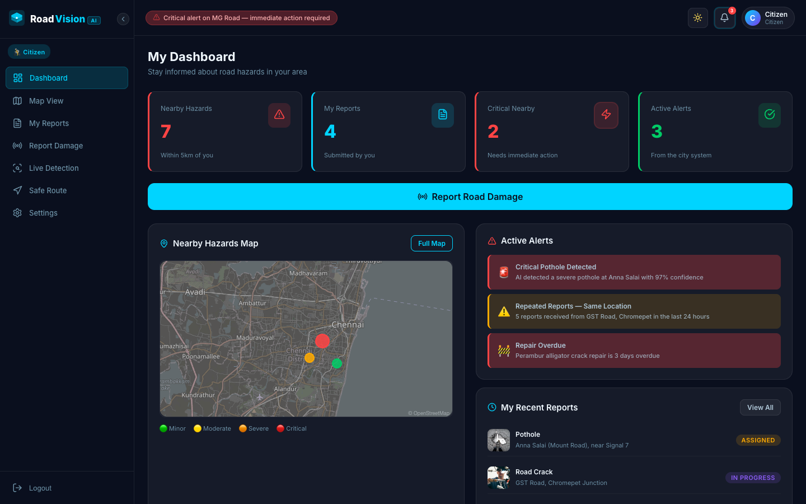

### Citizen — Report Damage
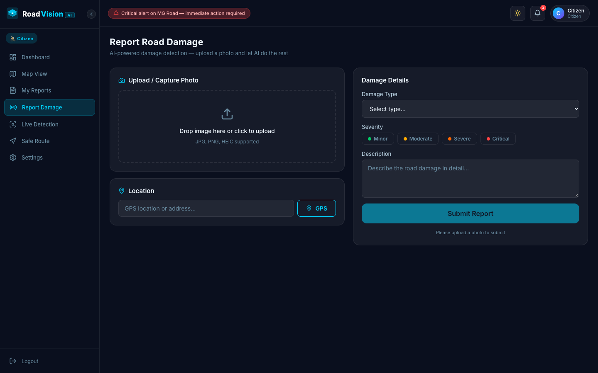

### Citizen — Safe Route
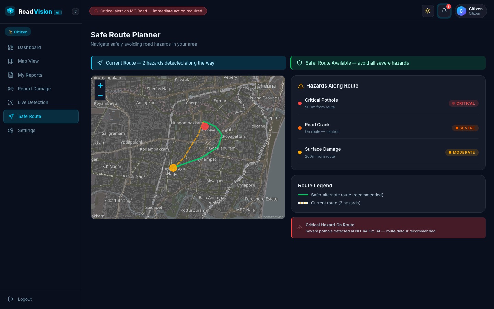

### Maintenance — Task Dashboard
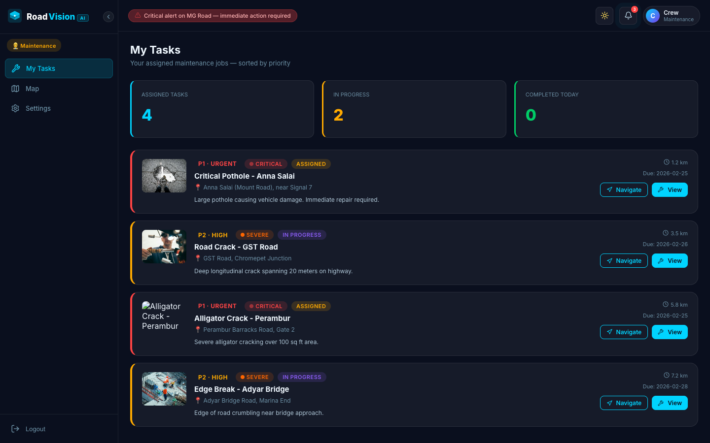

### Light Mode
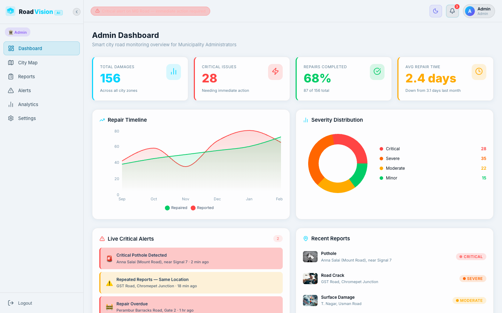

### Mobile — Account Menu
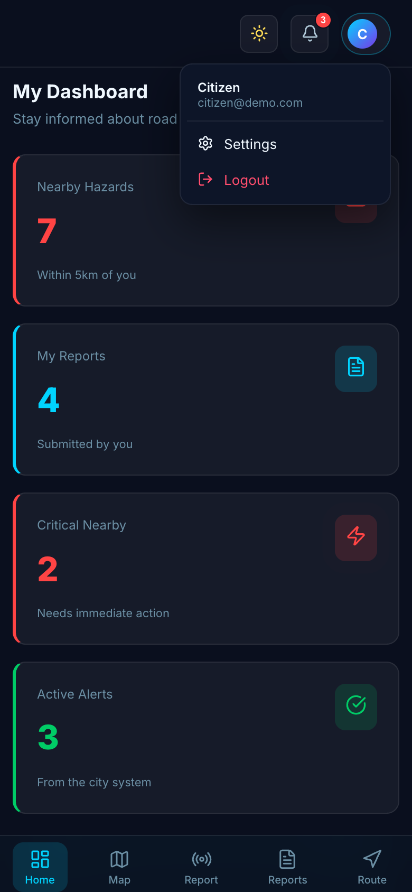

---

## 🧱 Tech Stack

| Layer | Tech |
|-------|------|
| Frontend | React 19, Vite, React Router, Recharts, React-Leaflet, Framer Motion, Lucide icons |
| Backend | FastAPI, Uvicorn |
| AI / ML | Ultralytics YOLOv8, PyTorch, OpenCV |
| Maps | OpenStreetMap tiles via Leaflet |

## 📁 Project Structure

```
RoadVision-AI/
├── src/                     # React frontend
│   ├── components/Layout/   # Sidebar, Navbar (account menu), MobileNav
│   ├── context/             # Auth + Theme providers
│   ├── pages/
│   │   ├── citizen/         # Dashboard, Report Damage, Live Detection, Map, Safe Route
│   │   ├── admin/           # Dashboard, City Map, Reports, Analytics, Alerts
│   │   └── maintenance/     # Task dashboard + task detail
│   └── data/mockData.js     # Demo data
├── backend/
│   ├── main.py              # FastAPI app — POST /detect
│   ├── road_damage_best.pt  # Trained YOLOv8 road damage model
│   ├── Dockerfile           # Container for Hugging Face Spaces / any Docker host
│   └── requirements.txt
├── yolov8_webcam_detection/ # Standalone OpenCV webcam detection script
└── screenshots/
```

---

## 🚀 Getting Started

### Prerequisites
- Node.js 18+
- Python 3.10 or 3.11 (PyTorch does not support the newest Python versions yet)

### 1. Backend (FastAPI + YOLOv8)

```bash
cd backend
python3.11 -m venv .venv
source .venv/bin/activate
pip install -r requirements.txt pillow
uvicorn main:app --port 8000
```

The API runs at http://localhost:8000.

### 2. Frontend (React + Vite)

```bash
npm install
npm run dev
```

Open **http://localhost:5173/RoadVision-AI/**.

To point the frontend at a different backend, set `VITE_API_URL`:

```bash
VITE_API_URL=https://your-backend.example.com npm run dev
```

### 🔑 Demo Login

On the login screen, click a **Quick Demo** button (citizen, admin or maintenance) and then **Sign In**. Authentication is mocked for demo purposes.

---

## 🔌 API

### `POST /detect`

Upload an image as multipart form field `file`.

```bash
curl -X POST http://localhost:8000/detect -F "file=@road.jpg"
```

```json
{
  "detections": [
    { "box": [120.5, 88.0, 340.2, 260.7], "confidence": 0.82, "label": "Pothole", "class_id": 3 }
  ],
  "is_specialized": true,
  "summary": { "count": 1, "classes": ["Pothole"] }
}
```

Low-confidence images (0.1–0.3) are saved to `backend/training_data_enrichment/` for future retraining (active learning).

---

## ☁️ Deployment

- **Frontend:** `npm run deploy` publishes to GitHub Pages (uses the `homepage` field in `package.json`).
- **Backend:** `backend/Dockerfile` is ready for a Docker host such as Hugging Face Spaces (port 7860). Build the frontend with `VITE_API_URL` set to the backend URL.

> Camera access for Live Detection requires HTTPS (or `localhost`).
